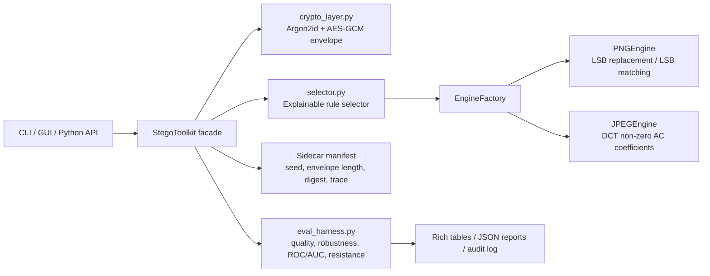

# Secure Adaptive Image Steganography Toolkit

Research prototype for PNG/JPEG steganography with mandatory cryptographic payload
protection, explainable configuration selection, transformation-aware evaluation,
and ROC/AUC-based steganalysis reporting.

> **Repository scope:** This is the source and evidence package supplied for
> Afif Jazimin's final-year project. The six included automated tests passed in
> a local run on 29 October 2026. The benchmark outputs are preliminary; see
> [SUBMISSION_NOTES.md](SUBMISSION_NOTES.md) for limits and
> [DATA_ATTRIBUTION.md](DATA_ATTRIBUTION.md) for the BOSSbase sample provenance.

This project follows the FYP scope: PNG spatial LSB matching/replacement, JPEG
DCT-domain coefficient embedding, Argon2id password hardening, AES-GCM
authenticated encryption, rule-based selection with a justification trace, and a
bounded resistance score.

## Features

- PNG spatial-domain embedding with LSB replacement and LSB matching.
- JPEG transform-domain embedding in quantized non-zero AC DCT coefficients.
- Mandatory Argon2id KDF and AES-GCM encryption before every embed operation.
- AEAD fail-closed extraction when a password, ciphertext, or transform corrupts
  the authenticated envelope.
- Explainable rule selector that emits a human-readable justification trace.
- Engine factory registry for future formats such as WebP, audio, or video.
- Rich/Typer CLI with progress bars, colored logs, and tabular reporting.
- Rich selector policy log for predictable, feedback-oriented XUI decisions.
- Feature-based steganalysis baseline using rich residual statistics and an
  Extra Trees ensemble classifier.
- Reproducible BOSSbase-sourced benchmark runner and baseline-vs-primary
  comparison evidence generator.
- CustomTkinter setup wizard with carrier selection, encryption setup,
  embedding, carrier analysis, security badges, preview panes, and a live
  resistance-score gauge.
- Multiprocessing detector scoring in the evaluation harness.
- Academic Markdown evaluation reports.
- Audit logging to `logs/stegtoolkit-audit.log`.

## Architecture



## Installation

```bash
python -m pip install .
```

For the desktop GUI:

```bash
python -m pip install ".[gui]"
```

For development tools:

```bash
python -m pip install ".[dev,gui]"
```

## Supervisor Quick Check

For a fast system check, open `RUN_ME_FIRST.md` first. The shortest verification
path is:

```bash
python -m pip install ".[dev]"
python -m pytest -q
python baseline_primary_comparison.py --samples 10 --output-dir evidence/baseline_primary_comparison_sample_10
```

Expected test result:

```text
6 passed
```

The full BOSSbase archive is not included because it is approximately 1.67 GB.
The package includes the dataset manifest, official source URL, hash, and a
BOSSbase-sourced 30-image sample benchmark under
`datasets/bossbase_runs/sample_30/`.

## Quick Start: CLI

The CLI intentionally prompts for passwords instead of accepting them as command
arguments.

Embed a string payload:

```bash
stegtoolkit embed \
  --cover ./cover.jpg \
  --payload-string "classified test payload" \
  --output ./cover_stego.jpg \
  --expected-transforms jpeg_recompression
```

For CI or demos, read the password from stdin instead of an interactive prompt:

```bash
printf "%s\n" "$STEGO_PASSWORD" | stegtoolkit embed \
  --cover ./cover.png \
  --payload-string "test payload" \
  --output ./cover_stego.png \
  --password-stdin
```

Analyze carrier capacity before embedding:

```bash
stegtoolkit analyze-carrier --carrier ./cover.jpg
```

Extract a payload:

```bash
stegtoolkit extract \
  --stego ./cover_stego.jpg \
  --output ./recovered.bin
```

Evaluate one cover/stego pair:

```bash
stegtoolkit evaluate \
  --cover ./cover.jpg \
  --stego ./cover_stego.jpg \
  --json-output ./reports/evaluation.json \
  --markdown-output ./reports/report.md
```

Batch evaluation:

```json
[
  { "cover": "./cover_001.jpg", "stego": "./cover_001_stego.jpg" },
  { "cover": "./cover_002.png", "stego": "./cover_002_stego.png" }
]
```

```bash
stegtoolkit batch-evaluate \
  --pairs-json ./pairs.json \
  --json-output ./reports/batch.json \
  --max-workers 4
```

## Quick Start: GUI

```bash
stegtoolkit-gui
```

GUI setup wizard:

1. Drag a PNG/JPEG carrier into the window or choose it with the file picker.
2. Review the carrier analysis dashboard with metadata and steganographic
   capacity.
3. Enter a payload and password in the encryption setup step.
4. Review the security dashboard, which displays the Argon2id and AES-GCM
   defaults used by the toolkit.
5. Click `Encrypt + Embed`.
6. Review the cover/stego preview panes and selector trace.
7. Click `Evaluate Resistance` to update the resistance-score gauge.

Security badges use perceptible color cues:

| Badge | Meaning |
| --- | --- |
| Green | High resistance or secure workflow step complete |
| Yellow | Moderate measured resistance |
| Red | High risk or blocking error |

Drag-and-drop requires the optional `tkinterdnd2` dependency. If it is not
available, the file picker remains fully supported.

## Evaluation Protocol

The evaluation protocol follows the FYP design:

1. Load a cover image and its generated stego image.
2. Compute imperceptibility metrics:
   - MSE
   - PSNR
   - SSIM
3. Apply controlled transformations:
   - JPEG recompression at quality factors 75, 85, and 90
   - Resize round trip
   - Center crop and pad
   - Gaussian noise with a fixed seed
4. Attempt extraction after each transform.
5. Treat authenticated mismatch or extraction error as secure fail-closed
   behavior, not as robustness success. Robustness success is counted only when
   the original authenticated payload is recovered after the transformation.
6. Generate detector scores and ROC/AUC reporting.
7. Compute the bounded resistance score:

```text
Quality_Score = SSIM * 100
Robustness_Score = successful_extractions / total_attempted_transforms * 100
Evasion_Score = (1.0 - max(0.5, ROC_AUC)) * 200
Final_Score = mean(Quality_Score, Robustness_Score, Evasion_Score)
```

The default detector is a local feature-based ensemble baseline. It extracts
high-pass residual histograms, residual co-occurrences, and block-DCT magnitude
histograms from cover/stego patches, then trains a deterministic Extra Trees
classifier. If an image is too small to provide enough patches, the toolkit
falls back to a deterministic proxy detector and labels the fallback in the
evaluation output.

The CLI writes a Markdown report by default to `report.md` unless another path is
provided with `--markdown-output`.

## Tests And Evidence

Run the automated test suite:

```powershell
python -m pytest -q
```

The included tests cover PNG unmodified-carrier roundtrip, AES-GCM fail-closed
behavior, selector rule decisions, and the bounded resistance-score formula.

Generate baseline-vs-primary comparison evidence:

```powershell
python baseline_primary_comparison.py --samples 10 --output-dir evidence\baseline_primary_comparison_sample_10
```

This writes JSON and Markdown outputs to
`evidence/baseline_primary_comparison_sample_10/` comparing PNG LSB replacement
against PNG LSB matching, and JPEG standard DCT against robust DCT with
Reed-Solomon ECC. The included 10-sample comparison is preliminary comparison
evidence, not a claim of universal robustness.

Run a BOSSbase-sourced benchmark sample:

```powershell
python bossbase_benchmark.py --archive datasets\BOSSbase_1.01.zip --output-dir datasets\bossbase_runs\sample_30 --limit 30 --formats PNG,JPEG
```

BOSSbase 1.01 stores grayscale PGM images. Since the toolkit scope is PNG/JPEG,
the benchmark converts selected BOSSbase source images into PNG/JPEG carriers
before embedding and evaluation.

Included sample evidence:

- `evidence/baseline_primary_comparison_sample_10/`: 10 synthetic cover samples
  comparing PNG/JPEG baseline and primary methods directly.
- `datasets/bossbase_runs/sample_30/`: 30 BOSSbase source images converted into
  PNG and JPEG carriers, producing 60 evaluated cover/stego pairs.

The current detector AUC, transformation-survival, and resistance-score outputs
should be presented as preliminary findings until the final FYP 2 evaluation
sample is fixed and reported.

## Security Model

- Payloads are never embedded as plaintext.
- The serialized envelope stores KDF parameters, salt, nonce, and AES-GCM
  ciphertext.
- AES-GCM nonces are generated through a local monotonic counter policy by
  default. Each key context receives a random nonce prefix and an incrementing
  64-bit counter; encryption is denied if the counter is exhausted.
- Envelope headers are authenticated as AEAD associated data.
- Extraction requires the manifest sidecar for deterministic seed, selected
  configuration, embedded envelope length, and ciphertext digest.
- Wrong passwords, tampering, or corrupted embedded bytes raise authentication
  failure and do not return partial plaintext.

Default cryptographic parameters:

| Component | Default |
| --- | --- |
| KDF | Argon2id |
| Memory | 256 MiB |
| Iterations | 3 |
| Parallelism | 4 |
| Cipher | AES-GCM |
| Key size | 256 bits |
| Nonce size | 96 bits |

## Python API

```python
from main import StegoToolkit

toolkit = StegoToolkit()

embed_result = toolkit.protect_and_embed(
    cover_path="cover.jpg",
    payload_bytes=b"secret payload",
    password="correct horse battery staple",
    expected_transforms=["jpeg_recompression"],
    output_path="cover_stego.jpg",
)

payload = toolkit.extract_and_verify(
    stego_path=embed_result["stego_path"],
    password="correct horse battery staple",
)

report = toolkit.run_evaluation(
    cover_path="cover.jpg",
    stego_path=embed_result["stego_path"],
)
```

## Project Files

| File | Purpose |
| --- | --- |
| `crypto_layer.py` | Argon2id + AES-GCM envelope encryption and authentication. |
| `stego_engines.py` | PNG/JPEG engines and engine factory registry. |
| `selector.py` | Explainable rule-based configuration selector. |
| `eval_harness.py` | Transform, quality, detectability, and resistance scoring. |
| `main.py` | Python facade and Rich/Typer CLI. |
| `gui.py` | CustomTkinter desktop app. |
| `pyproject.toml` | Packaging metadata and console scripts. |

## Audit Logs

CLI and GUI runs initialize file logging at:

```text
logs/stegtoolkit-audit.log
```

The log records selected rules, output paths, evaluation runs, and controlled
errors. Passwords and plaintext payloads are not logged.

## Development Checks

```bash
python -m py_compile crypto_layer.py stego_engines.py selector.py eval_harness.py main.py gui.py
python stego_engines.py
python selector.py
python eval_harness.py
```

## Extension Notes

To add a new carrier format:

1. Implement a class derived from `StegoEngine`.
2. Add capacity, embed, and extract behavior.
3. Register the class with `EngineFactory.register("WEBP", WebPEngine)`.
4. Extend selector rules to produce the new format configuration.
5. Add evaluation fixtures and README documentation.
